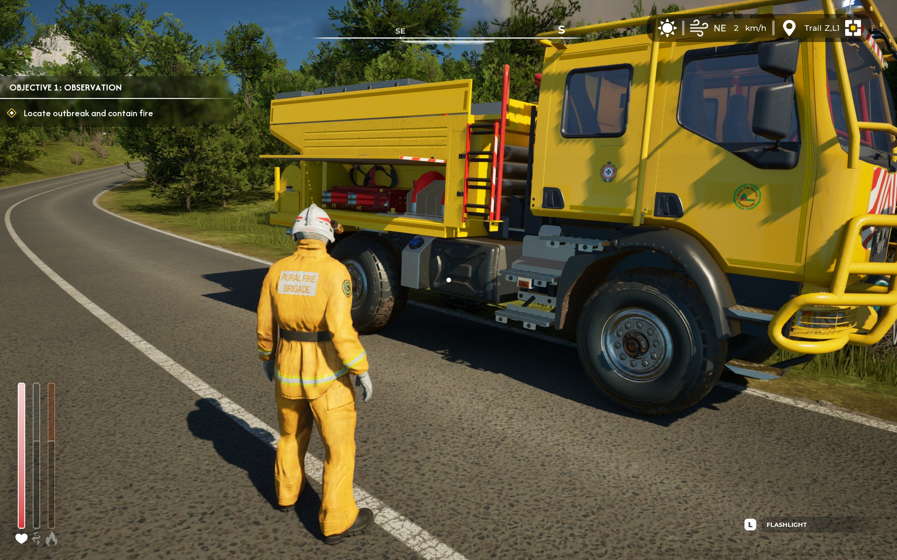

**Rescue Ops: Wildfire** is built on **Unreal Engine 5.8.1**. As far as we know these are the first published mods for it. This site is the result of many hours of testing: it skips the dead ends and shows you only what works. Every method here is confirmed in-game on the Steam demo build (October 2026).

## How modding works in this game

The game stores its content in Unreal **IoStore** containers (`.pak` + `.utoc` + `.ucas`) in `Wildfire\Content\Paks\`. They are **not encrypted and not signed**, and the game has **no anti-cheat**. Unreal loads extra containers whose names end in `_P` (for "patch") after the base game, and anything inside them overrides the original asset at the same path.

So a mod is:

1. a replacement asset (texture, sound…) created in a **blank Unreal 5.8 project named `Wildfire`**, saved at **exactly the same path and name** as the game's asset,
2. cooked and packaged into its own chunk,
3. renamed to `z_<YourMod>_P.pak/.utoc/.ucas` and dropped into the game's `Paks` folder.

No game file is ever edited. Uninstalling means deleting the three files.

## What's been proven

| Asset type | Status | Tutorial |
|---|---|---|
| Textures (diffuse, normal, roughness/metallic) | ✅ Works, including 4K | [Retexturing](/tutorials/retexturing/) |
| Sounds (SoundWave behind a MetaSound) | ✅ Works | [Replacing sounds](/tutorials/sounds/) |
| Static mesh swap, with its own material and textures | ✅ Works, including LODs, sockets and the game's own materials | [Replacing 3D models](/tutorials/models/) |
| Materials driven by the game (light on/off signal, flashing, glow) | ✅ Works: new colour, brightness, random flash patterns, glow | [Emergency lights](/tutorials/emergency-lights/) |
| Lua / runtime scripting (UE4SS) | ❌ Crashes on map load. Not needed: download the `.usmap` instead | [Get the .usmap](/start/usmap/) |

## Where to start

1. Install the [tools](/start/tools/) and [set up FModel](/start/fmodel/) with the `.usmap`.
2. [Set up the mod project](/start/mod-project/) once.
3. Follow [Retexturing](/tutorials/retexturing/) or [Replacing sounds](/tutorials/sounds/), then [package and install](/start/packaging/).

Just want to play with mods? [Browse the mods](/mods/) and see [Installing mods](/mods/installing/).

:::caution[Only ever add files]
Never modify, delete or repack the game's own `.pak`/`.utoc`/`.ucas` files. Mods are separate `z_*_P` files that you can remove at any time.
:::
