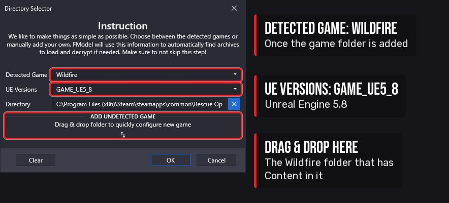
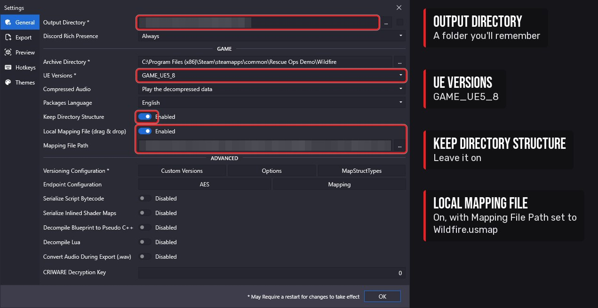
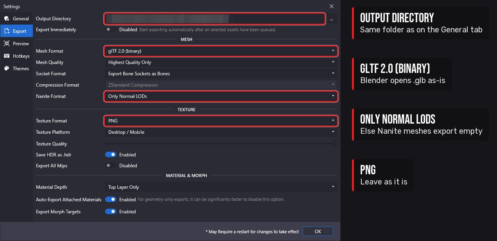
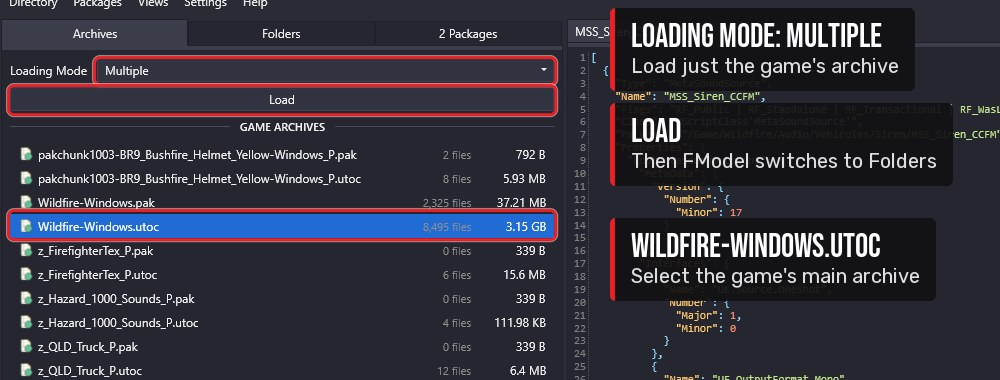

import { LinkButton, Steps } from '@astrojs/starlight/components';
import Clip from '../../../components/Clip.astro';

:::note[In this tutorial you will learn]
- How to install FModel and add the game to it
- Where to put the `.usmap` mapping file and how to load it
- Every FModel setting you need to change, and why
- How to check everything works
:::

FModel is a free viewer for Unreal Engine game files. You use it to find the game's models, textures and sounds, and to export the originals you work from. It only reads the game's files. It never changes them.

FModel's default settings won't work for this game. Go through every step below, even if FModel seems to open fine without them.

## Settings you'll change

| Where | Setting | Change to | Why |
|---|---|---|---|
| Directory Selector | Game | Add `Wildfire` by hand | FModel doesn't detect this game |
| Directory Selector | **UE Versions** | `GAME_UE5_8` | The game is Unreal Engine 5.8 |
| Settings → General | **Local Mapping File** + **Mapping File Path** | Ticked, `Wildfire.usmap` | Without it FModel can't open most assets |
| Settings → General | **Output Directory** | A folder you choose | Where textures, properties and audio are saved |
| Settings → Export | **Output Directory** | The same folder | Models have their own export folder |
| Settings → Export | **Mesh Format** | `glTF 2.0 (binary)` | Exports `.glb` files that Blender opens without add-ons |
| Settings → Export | **Nanite Format** | `Only Normal LODs` | Otherwise the trucks export as empty files |
| Archives tab | **Loading Mode** | `Multiple` | Lets you load just the game's archive, as the tutorials show |

## Step 1: Install FModel

<Steps>

1. Download the latest FModel from its [GitHub releases page](https://github.com/4sval/FModel/releases) (or [fmodel.app](https://fmodel.app)). It's a single `FModel.exe`, with no installer.

2. Make a folder for it, for example `Documents\FModel`, and put `FModel.exe` there. FModel creates its `Output` folder next to the `.exe`, so don't run it from `Downloads`.

3. Double-click `FModel.exe`. If Windows asks you to install the **.NET Desktop Runtime**, follow the link it shows (or get it from [Microsoft's .NET download page](https://dotnet.microsoft.com/download/dotnet/10.0)), install it, and open FModel again.

</Steps>

## Step 2: Add the game

FModel doesn't detect Rescue Ops: Wildfire automatically, so you add it by hand. The **Directory Selector** window opens the first time you run FModel. Later you can open it from the **Directory → Selector** menu.

<Steps>

1. Find the game folder: in Steam, right-click the game → **Manage → Browse local files**. For the demo that's usually:

   ```text
   C:\Program Files (x86)\Steam\steamapps\common\Rescue Ops Demo\
   ```

   Inside it is a folder called `Wildfire` (the one that contains `Content`). That's the folder FModel needs:

   ```text
   C:\Program Files (x86)\Steam\steamapps\common\Rescue Ops Demo\Wildfire
   ```

2. Drag that `Wildfire` folder from File Explorer onto the Directory Selector window, where it says *Drag & drop folder to quickly configure new game*.

   Or add it by hand: expand the section under that text, set **Name** to `Wildfire`, click **…** next to **Directory** and select the `Wildfire` folder, then click the **Add Game** button (**+**).

3. Make sure **Detected Game** now shows `Wildfire`.

4. Set **UE Versions** to `GAME_UE5_8`.

   

5. Click **OK**. FModel reloads with the game.

</Steps>

No AES key is needed. The game isn't encrypted.

## Step 3: Load the mapping file

The game is cooked with unversioned properties, so FModel can list its files but can't open most of them without a `.usmap` mapping file. Download ours:

<LinkButton href="https://github.com/TonnieGit/rescueopsmodding/releases/latest/download/Wildfire.usmap" icon="download">Download Wildfire.usmap (2.8 MB)</LinkButton>

<Steps>

1. Move `Wildfire.usmap` into the folder you made for FModel, for example `Documents\FModel\Wildfire.usmap`. FModel reads it from there every time it starts, so don't leave it in `Downloads` where it might get cleaned up.

2. In FModel, open **Settings** (top menu) and stay on the **General** tab.

3. Tick **Local Mapping File**.

4. Next to **Mapping File Path**, click **…** and select `Wildfire.usmap`. You can also drag the file onto that box.

5. Check **UE Versions** on this tab also says `GAME_UE5_8`.

   

6. Don't close Settings yet. Carry on with Step 4.

</Steps>

The mapping was made from the October 2026 demo build. See [Get the .usmap](/start/usmap/) for which game version it matches and how to make a new one after a game update.

## Step 4: Set the export folders and formats

<Steps>

1. Still on **Settings → General**, set **Output Directory** to a folder you'll remember, for example `Documents\FModel\Output`. Properties (`.json`) and audio are saved in an `Exports` folder inside it.

2. Leave **Keep Directory Structure** ticked. Exports are then saved under the game's own folder paths, so you always know where a file came from.

3. Click the **Export** tab.

4. Set this tab's **Output Directory** to the same folder. Models, and textures you export with **Export → Texture**, use this one instead of the folder on the General tab.

5. Set **Mesh Format** to `glTF 2.0 (binary)`. Models then export as `.glb` files that Blender imports with no add-ons.

6. Set **Nanite Format** to `Only Normal LODs`.

7. Leave **Texture Format** on `PNG`.

   

8. Click **OK**, then close and reopen FModel so the mapping file loads.

</Steps>

:::caution[Gotcha: model exports are empty 160-byte files]
**Cause:** the trucks and some other meshes use Nanite. FModel's default **Nanite Format**, `Only Nanite LOD`, saves a `.glb` with nothing in it for these meshes.

**Fix:** set **Settings → Export → Nanite Format** to `Only Normal LODs` and export again.

**How we found it:** the truck body `S_CCF.glb` came out at 160 bytes while the skeletal chassis exported fine. After changing the setting, all 41 truck meshes exported with their UVs.
:::

:::caution[Gotcha: models and textures end up in different folders]
**Cause:** models and textures (**Export → Model**, **Export → Texture**) use the **Output Directory** on the **Export** tab. Properties (`.json`) use the one on the **General** tab. Changing one doesn't change the other.

**Fix:** set both to the same folder (Step 4).
:::

## Step 5: Set the loading mode

<Steps>

1. In the main window, click the **Archives** tab.

2. Set **Loading Mode** to `Multiple`.

3. Select `Wildfire-Windows.utoc` in the list and click **Load**.

   

</Steps>

FModel remembers this. Each time you open it, select `Wildfire-Windows.utoc` and click **Load**. The tutorials on this site start from that point.

## Step 6: Check it works

<Steps>

1. After **Load**, FModel shows the **Folders** tab, with the open folder's contents as tiles on the right. Double-click the tiles `Content` → `Wildfire` → `Textures` → `Vehicles` → `CCF` → `VariousTiling`.

2. Double-click the `T_CCF_VariousTiling_D` tile.

   <Clip
   	src="/media/tutorials/fmodel/step6.mp4"
   	poster="/media/tutorials/fmodel/step6.jpg"
   	caption="Double-click your way to Textures/Vehicles/CCF/VariousTiling and open the colour texture."
   />

3. You should see the fire truck's colour texture (a grid of colour blocks with red along the bottom half). If you get an error instead, the mapping file isn't loaded: go back to Step 3.

</Steps>

Next: [set up the mod project](/start/mod-project/). When you're ready to find and export assets, [Retexturing](/tutorials/retexturing/) shows how to work out which textures a model uses.
