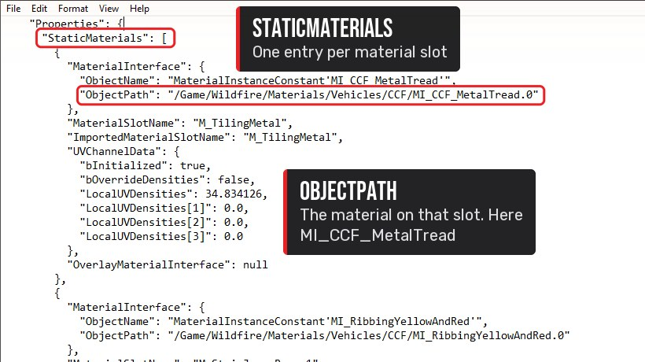
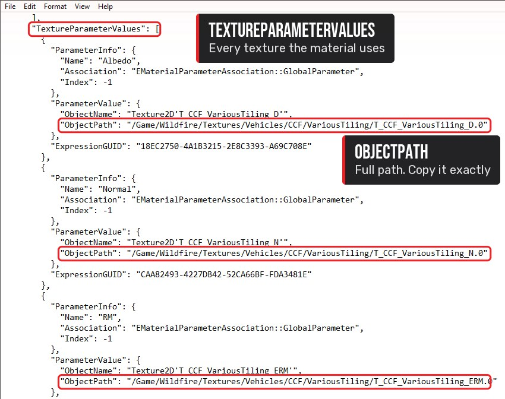
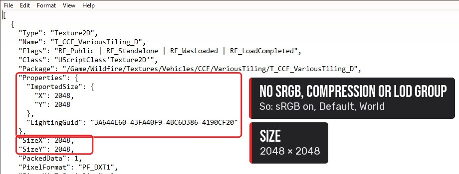
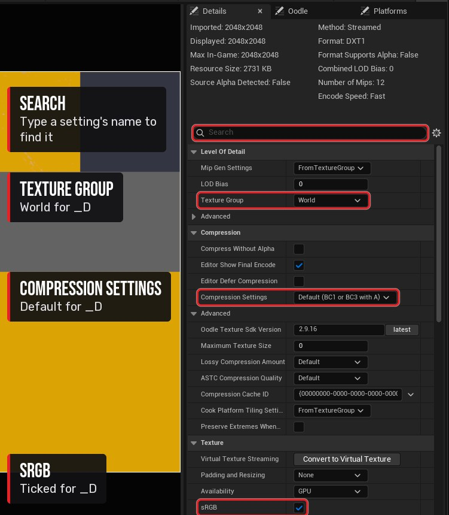
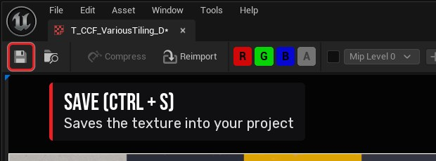
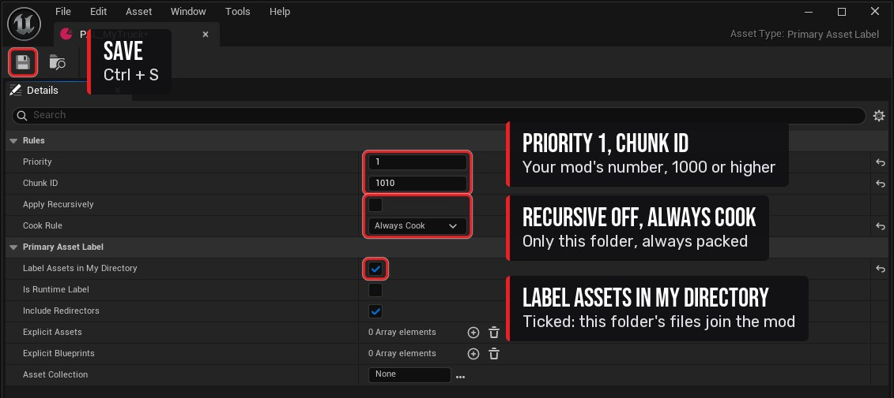

import { Steps } from '@astrojs/starlight/components';
import Clip from '../../../components/Clip.astro';

:::note[In this tutorial you will learn]
- How to find which textures a model (a vehicle, character or prop) uses
- How to export the original textures and their settings
- How to import your new textures into Unreal with the right settings
- How to package them so they show up in-game
:::

:::tip[Before you start]
You need the [tools](/start/tools/) installed, [FModel set up](/start/fmodel/) with the `.usmap`, and the [mod project](/start/mod-project/) set up.
:::

## How retexturing works

The game loads every texture by its path, for example:

```text
/Game/Wildfire/Textures/Vehicles/CCF/VariousTiling/T_CCF_VariousTiling_D
```

If your mod contains a texture with **exactly the same path and name**, the game uses yours instead. You don't touch the model or its materials: the game's own materials pick up your texture automatically.

The examples below use the CCF fire truck, but the steps are the same for any model.

## Step 1: Find the model in FModel

<Clip
	src="/media/tutorials/retexturing/step1.mp4"
	poster="/media/tutorials/retexturing/step1.jpg"
	caption="Load the archive, double-click your way to Vehicles/CCF and open S_CCF in the 3D viewer."
/>

<Steps>

1. Open FModel. In the **Archives** tab, select `Wildfire-Windows.utoc` and click **Load**. FModel switches to the **Folders** tab: the folder tree is on the left, and the open folder's contents show as tiles on the right.

2. Double-click the `Content` tile, then `Wildfire`. The useful folders are:

   | Folder | Contains |
   |---|---|
   | `Vehicles/` | Vehicle meshes, e.g. `Vehicles/CCF/S_CCF` (truck body) |
   | `Characters/` | Character meshes, e.g. `Characters/Firefighter/SK_Firefighter` |
   | `StaticMeshes/` | Props and environment, e.g. `StaticMeshes/Props/FirefighterEquipment/S_FirefighterHelmet` |
   | `Materials/` | Materials (`M_`) and material instances (`MI_`) |
   | `Textures/` | Textures, in folders that mirror the ones above |

   The path above the tiles shows where you are. Click any part of it to go back up.

3. Double-click your way to the model's folder, e.g. `Vehicles` → `CCF`. Mesh names start with `S_` (static) or `SK_` (skeletal, i.e. animated), and each tile shows its type under the name.

4. Double-click a mesh to open the **3D viewer** and make sure it's the one you want. Close the viewer with its **X** button.

</Steps>

:::caution[Gotcha: FModel shows the files but won't open anything]
**Cause:** the mapping file isn't loaded. The game uses unversioned properties, so FModel can list files but not read them.

**Fix:** *Settings → General* → set UE version to `GAME_UE5_8`, tick **Local Mapping File** and select your `.usmap` ([how](/start/fmodel/#step-3-load-the-mapping-file)). Restart FModel.
:::

:::caution[Gotcha: FModel stopped opening folders after I used the 3D viewer]
**Cause:** pressing **Esc** hides the 3D viewer but doesn't close it, so FModel stays busy (the status bar stays orange on *Loading…* or *Stopping*) and ignores double-clicks.

**Fix:** close the viewer with its **X** button. If FModel is already stuck, restart it.
:::

:::tip[Getting the tiles back]
Opening an asset shows its properties on the right and switches the left panel to the **Packages** list. To browse again, click the **Folders** tab, then the folder icon in the bottom-right corner of the right-hand panel.
:::

## Step 2: Find the textures it uses

<Steps>

1. Right-click the mesh's tile → **Export** → **Properties (.json)**.

   <Clip
   	src="/media/tutorials/retexturing/step2a.mp4"
   	poster="/media/tutorials/retexturing/step2a.jpg"
   	caption="Right-click S_CCF, then Export, then Properties (.json)."
   />

2. Open the saved `.json` in a text editor (Notepad, VS Code). Search for `StaticMaterials` (static mesh) or `SkeletalMaterials` (skeletal mesh). Each material slot looks like this:

   ```json
   "MaterialInterface": {
     "ObjectPath": "/Game/Wildfire/Materials/Vehicles/CCF/MI_CCF_VariousTiling.0"
   },
   "MaterialSlotName": "M_LPsVarious"
   ```

   The `ObjectPath` is the material on that part of the model.

   

3. In FModel, browse to that material (here `Materials/Vehicles/CCF/MI_CCF_VariousTiling`), right-click it → **Export** → **Properties (.json)**.

   <Clip
   	src="/media/tutorials/retexturing/step2c.mp4"
   	poster="/media/tutorials/retexturing/step2c.jpg"
   	caption="Browse to Materials/Vehicles/CCF and export MI_CCF_VariousTiling's properties."
   />

4. Open that `.json` and find `TextureParameterValues`. It lists every texture the material uses: each entry has the texture's job (`Name`) and its full path (`ObjectPath`):

   ```json
   "TextureParameterValues": [
     {
       "ParameterInfo": { "Name": "Albedo", ... },
       "ParameterValue": {
         "ObjectName": "Texture2D'T_CCF_VariousTiling_D'",
         "ObjectPath": "/Game/Wildfire/Textures/Vehicles/CCF/VariousTiling/T_CCF_VariousTiling_D.0"
       }
     },
     ...
   ```

   Here that's `Albedo` (colour, `_D`), `Normal` (`_N`) and `RM` (masks, `_ERM`).

   

   Further down, `ReferencedDefaultTextures` also lists textures under `Textures/FXs/`, `Textures/Firefront/` or `/Engine/`. Ignore those: they're shared effects such as rain and burn marks, not the model's paint.

5. Repeat for each material slot you want to change.

</Steps>

:::caution[Gotcha: I changed the suit and the helmet changed too]
**Cause:** textures are shared. The firefighter body textures (`T_FirefighterBody_*`) paint the suit **and** the helmet, and the truck's colour sheet covers the body, doors and chassis.
**How we found it:** we overlaid the helmet's UVs on the suit texture and they shared the same image. Before painting over an area that looks unused, check the UVs of every model that uses the material.
:::

## Step 3: Export the original textures

For **each** texture you want to change:

<Steps>

1. Browse to it in FModel (e.g. `Textures/Vehicles/CCF/VariousTiling/`).

2. Right-click → **Export** → **Texture**. FModel adds the texture to its export queue: click **Queued Items** at the bottom right of the status bar, then **Export**, then **OK**. This saves a PNG to paint on.

   <Clip
   	src="/media/tutorials/retexturing/step3a.mp4"
   	poster="/media/tutorials/retexturing/step3a.jpg"
   	caption="Export the texture: right-click, Export, Texture, then run the export queue."
   />

3. Click the folder icon at the bottom right of the preview to get the tiles back, then right-click the texture → **Export** → **Properties (.json)**. This records the settings you'll copy into Unreal.

   <Clip
   	src="/media/tutorials/retexturing/step3b.mp4"
   	poster="/media/tutorials/retexturing/step3b.jpg"
   	caption="Back to the tiles, then export the texture's properties."
   />

4. Open the texture's `.json` and note:
   - `SRGB`: if it's **missing**, it's on (true)
   - `CompressionSettings`: if it's **missing**, it's Default
   - `LODGroup`: if it's **missing**, it's World
   - the texture's size (`SizeX`, `SizeY`)

   

</Steps>

To paint directly on the model in Substance Painter or Blender, also export the mesh: right-click it → **Export** → **Model**. That gives a `.glb` with UVs.

:::caution[Gotcha: the exported model is an empty 160-byte file]
**Cause:** vehicles and many props use **Nanite**, and FModel's default exports only the Nanite data, which is empty in a `.glb`.

**Fix:** *Settings → Export → Nanite Format* → `Only Normal LODs`, then export again. We found this when every truck part came out at exactly 160 bytes.
:::

:::caution[Gotcha: I can't find my exports]
FModel saves exports to the output folders you set in [Set up FModel → Step 4](/start/fmodel/#step-4-set-the-export-folders-and-formats). Copy the files from there into a folder of your own, and keep the originals untouched so you can always go back.
:::

## Step 4: Make your new texture

Open the PNG in your texturing software of choice: Photoshop, GIMP, Krita, Substance Painter… Paint whatever you like, but keep to these rules so it works in-game:

- **Keep the UV layout.** Don't move or resize anything within the image.
- **Keep the channel layout.** What a texture holds depends on its suffix:

  | Suffix | Contains | Notes |
  |---|---|---|
  | `_D` | Colour | Paint normally |
  | `_N` | Normal map | Only edit it to change surface detail |
  | `_RM` / `_ERM` | Packed masks | **R = 0** (keep black), **G = roughness**, **B = metallic** |

- **Size:** the same as the original or bigger. **4096 × 4096** works and is noticeably sharper than the game's 2048.
- **Save as PNG**, named exactly like the game texture, e.g. `T_CCF_VariousTiling_D.png`.

:::caution[Gotcha: I painted over the old lettering but you can still read it in-game]
**Cause:** the colour is gone, but the original lettering is still **matte** in the roughness map and slightly **raised** in the normal map. It reflects light differently from the paint around it.

**Fix:** in the same area, set the `_ERM`/`_RM` green channel to the surrounding surface's roughness and the `_N` map to flat (128, 128, 255).

**How we found it:** we measured the pixel values. The truck's letters had roughness ≈ 92 against the body paint's ≈ 56.
:::

## Step 5: Import into Unreal

<Steps>

1. Open your `Wildfire` mod project. In the **Content Browser**, create the same folders as the game path. For `/Game/Wildfire/Textures/Vehicles/CCF/VariousTiling/` you create `Wildfire` → `Textures` → `Vehicles` → `CCF` → `VariousTiling` inside `Content`. Right-click → **New Folder** for each level.

2. Click **Import** in the Content Browser and pick your PNG (or drag it from Windows Explorer into the folder). Check the new asset's name matches the game texture **exactly**. If a texture with that name is already in the folder, Unreal asks whether to convert the import to a re-import: click **Yes**.

3. **Double-click** the texture. The **Texture Editor** opens with a preview on the left and the **Details** panel on the right.

   <Clip
   	src="/media/tutorials/retexturing/step5a.mp4"
   	poster="/media/tutorials/retexturing/step5a.jpg"
   	caption="Open the VariousTiling folder, import the PNG (re-importing over the existing texture) and open the Texture Editor."
   />

4. In the Details panel, set the following. Typing the setting name into the **search box** at the top of the Details panel is the quickest way to find each one:

   | Setting | `_D` (colour) | `_N` (normal) | `_RM` / `_ERM` (masks) |
   |---|---|---|---|
   | **Compression Settings** | Default | Normalmap | Masks |
   | **sRGB** | ✔ ticked | ✘ unticked | ✘ unticked |
   | **Texture Group** | World | WorldNormalMap | World |

   Leave everything else at its default.

   

5. Click **Save** in the Texture Editor's toolbar (or Ctrl + S), then close it.

   

</Steps>

:::caution[Gotcha: my texture looks washed out, too dark, or the lighting is wrong]
Nearly always the wrong **sRGB** or **Compression Settings**. Colour (`_D`) needs sRGB **on**. Normal maps and masks need it **off**, with Normalmap / Masks compression. Fix the setting, save and repackage.
:::

:::caution[Gotcha: the path has to be exact, typos and all]
The game's folders include spellings such as **`Vehicules`** (French) and capitals such as **`TrimSheet`**. One wrong letter and the game never finds your texture. Always copy the path from the FModel `.json` rather than typing it from memory.
:::

## Step 6: Add the texture to your mod

A **PrimaryAssetLabel** tells Unreal which files belong to your mod.

<Steps>

1. In the same folder, right-click empty space in the Content Browser → **Data** → **Data Asset**.

2. In the class picker, search for **PrimaryAssetLabel**, select it and click **Select**. Name it after your mod, e.g. `PAL_MyTruck`.

   <Clip
   	src="/media/tutorials/retexturing/step6.mp4"
   	poster="/media/tutorials/retexturing/step6.jpg"
   	caption="Right-click, Data, Data Asset, pick Primary Asset Label, then open it."
   />

3. Double-click it and set:

   | Setting | Value |
   |---|---|
   | Priority | `1` |
   | Chunk ID | your mod's number, **1000 or higher** (see the [Chunk ID registry](/reference/chunk-ids/)) |
   | Cook Rule | **Always Cook** |
   | Label Assets in My Directory | ✔ ticked |
   | Apply Recursively | ✘ unticked |

   

4. Save it.

</Steps>

If your textures are spread across several folders, put a label in **each** folder, all with the **same Chunk ID**.

:::caution[Gotcha: I copied a label into another folder and the wrong files ended up in my mod]
A duplicated label keeps the original's **Chunk ID**. We found our horn sound packed inside the siren mod this way. After copying a label, always open it and check its Chunk ID.
:::

## Step 7: Package and install

Follow [Package and install your mod](/start/packaging/). In short: **Platforms → Windows → Package Project**, check the build, then copy the three `pakchunk<ID>-Windows` files into the game's `Wildfire\Content\Paks\` folder, renamed to `z_<YourMod>_P`.

## Step 8: See it in-game

Start the game and go and look at your model.

:::caution[Gotcha: it works, but it looks blurry]
**Cause:** the game's default **Texture Quality** is Medium, which shows every texture at a **quarter** of its size. Your 2048 texture displays as 512.

**Fix:** set **Texture Quality to Epic** in the game's graphics settings, and tell your users to as well.

**How we found it:** the player's `GameUserSettings.ini` had no texture quality set, and the game's default applies a mip bias of 2.
:::

Still seeing the original texture? See [Troubleshooting](/start/troubleshooting/#my-mod-doesnt-show-up-in-game).

## See also

- [Texture formats](/reference/texture-formats/): settings and channel layouts for every texture type
- [Asset paths](/reference/asset-paths/): firefighter, truck and helmet texture paths
- [CCF truck](/reference/ccf-truck/): which truck texture controls which part
