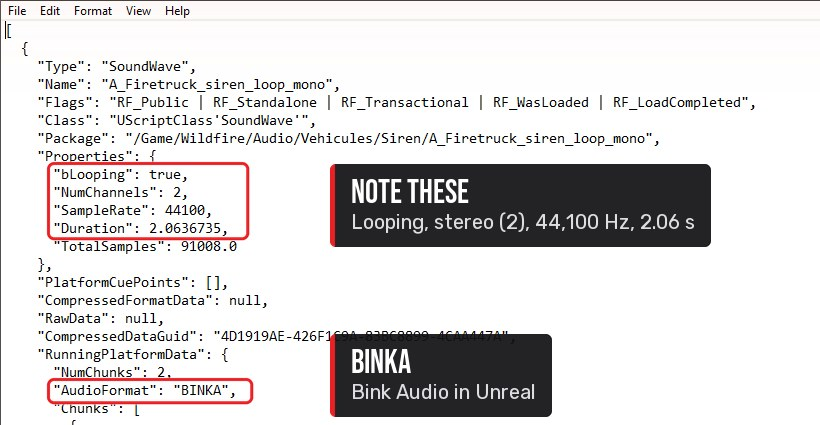
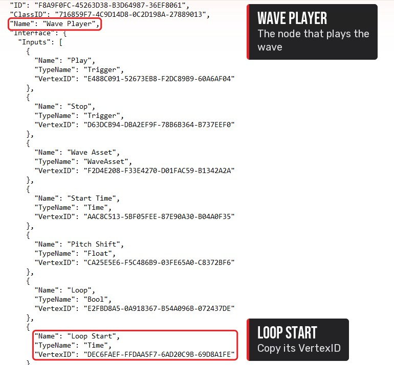
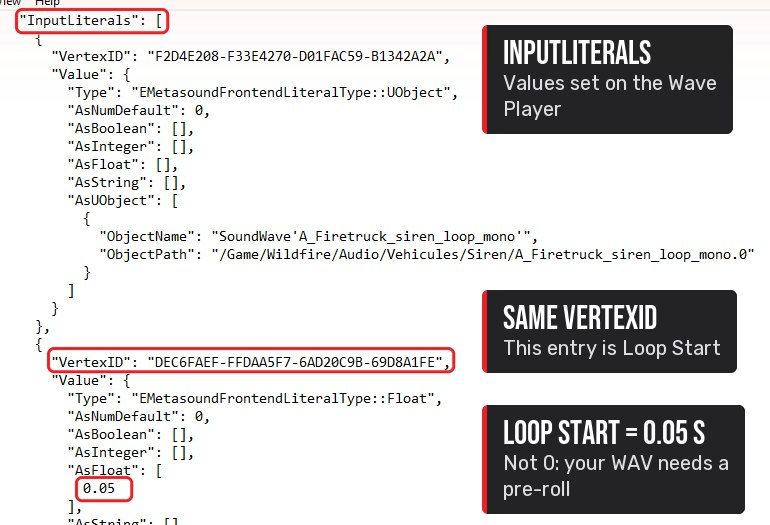
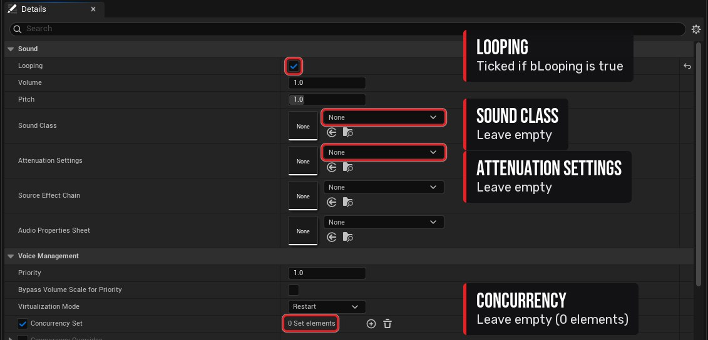
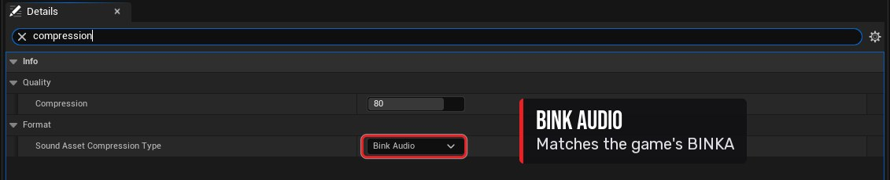

import { Steps } from '@astrojs/starlight/components';
import Clip from '../../../components/Clip.astro';

:::note[In this tutorial you will learn]
- How the game plays sounds, and which file you actually replace
- How to find a sound and read the settings that matter
- How to prepare a WAV that loops without clicks
- How to import it into Unreal and get it into the game
:::

:::tip[Before you start]
You need the [tools](/start/tools/) installed, [FModel set up](/start/fmodel/) with the `.usmap`, the [mod project](/start/mod-project/) set up, and an audio editor (Audacity is free).
:::

## How sounds work in this game

The game uses Unreal's own audio system (no Wwise or FMOD). Each sound is two assets:

| Asset | Prefix | What it is | Replace it? |
|---|---|---|---|
| **SoundWave** | `A_` | The actual audio | ✔ **Yes, this one** |
| **MetaSound Source** | `MSS_` | The "player": looping, volume class, distance fade | ✘ **No, leave it** |

For example, the truck siren:

```text
/Game/Wildfire/Audio/Vehicules/Siren/A_Firetruck_siren_loop_mono   ← replace
/Game/Wildfire/Audio/Vehicules/Siren/MSS_Siren_CCFM                ← keep the game's
```

If you replace only the SoundWave, the game's MetaSound keeps doing its job: the volume sliders, distance fade-out and looping all keep working, with nothing extra to build.

## Step 1: Find the sound

<Steps>

1. In FModel's **Folders** tab, double-click the tiles `Content` → `Wildfire` → `Audio`. Vehicle sounds are in **`Audio/Vehicules/`** (French spelling), with a folder for each sound (`Siren`, `Horn`, …).

2. Each folder holds the MetaSound (`MSS_…`) and the wave (`A_…`). Double-click the wave to hear it in FModel's audio player and make sure it's the right one.

   <Clip
   	src="/media/tutorials/sounds/step1.mp4"
   	poster="/media/tutorials/sounds/step1.jpg"
   	caption="Content, Wildfire, Audio, Vehicules, Siren, then double-click the wave to hear it."
   />

</Steps>

## Step 2: Export the originals and read their settings

<Steps>

1. Right-click the **wave** (`A_…`) → **Export** → **Properties (.json)**.

2. Click the folder icon at the bottom right to get the tiles back, then right-click the **MetaSound** (`MSS_…`) → **Export** → **Properties (.json)**.

   <Clip
   	src="/media/tutorials/sounds/step2.mp4"
   	poster="/media/tutorials/sounds/step2.jpg"
   	caption="Export the wave's properties, back to the tiles, then the MetaSound's."
   />

3. Optional: double-click the wave and use the audio player's save button to keep a decoded `.wav` of the original for comparison.

4. In the **wave's** `.json`, note:
   - `NumChannels`: 1 = mono, 2 = stereo
   - `bLooping`
   - `SampleRate` and `Duration`

   

5. In the **MetaSound's** `.json`, find the **Wave Player** node. The important input is **`Loop Start`**. Its value isn't next to its name: note the input's `VertexID` in the node's `Inputs` list, then search the file for that `VertexID` again. The entry under `InputLiterals` holds the value (`AsFloat`).

   

   

</Steps>

:::caution[Gotcha: the "mono" siren is actually stereo]
`A_Firetruck_siren_loop_mono` has **2 channels**. Asset names aren't reliable, so always go by `NumChannels` in the `.json` and match it in your file.
:::

:::caution[Gotcha: my siren clicks every time it loops]
**Cause:** the siren's MetaSound has **Loop Start = 0.05 s**. After the first play-through it jumps from the end of the file back to **50 ms in**, not to the start. A WAV that loops perfectly end-to-start will click at every loop in-game.

**Fix:** see the pre-roll step below.

**How we found it:** by reading the Wave Player inputs in `MSS_Siren_CCFM.json` before building. The horn's MetaSound uses Loop Start 0, so it doesn't need this.
:::

## Step 3: Prepare your WAV

Use any audio editor. The file needs to be:

| Property | Value |
|---|---|
| Format | WAV, 16-bit PCM |
| Sample rate | 44,100 Hz |
| Channels | **Same as the original** (siren: stereo, so duplicate mono to both channels; horn: mono) |
| Level | Peaks around −1 dB, roughly as loud as the original |
| File name | Exactly the game asset's name, e.g. `A_Firetruck_siren_loop_mono.wav` |

**For looping sounds** (sirens, horns):

<Steps>

1. Cut the loop so the end flows straight back into the start. Make both cuts at a **zero crossing**, where the waveform crosses the centre line.

2. **If the MetaSound's Loop Start isn't 0**, add a **pre-roll**: copy the last *Loop Start* seconds of your loop (50 ms for the siren) and paste them at the very start of the file. The jump from the end back to 50 ms then lands exactly where the loop continues.

3. Optional: a very short fade-in (about 10 ms) over the pre-roll only, to avoid a pop when the sound switches on.

</Steps>

:::caution[Gotcha: short horn loops flutter or click]
Very short tonal loops click when the loop length doesn't line up with the tone's waveform. Make the loop a whole number of the tone's cycles long and crossfade the join by about 0.1 s.
:::

Only release audio you recorded yourself or have the rights to use.

## Step 4: Import into Unreal

<Steps>

1. In the Content Browser, create the same folders as the game path under `Content`. For the siren that's `Wildfire` → `Audio` → `Vehicules` → `Siren`. Note the French spelling.

2. Click **Import** in the Content Browser and pick your WAV (or drag it from Windows Explorer into the folder). Check the asset name matches the game's exactly. If the sound is already in your project, Unreal asks to overwrite it (**Yes**) and then whether to overwrite its settings too: **No** keeps the settings you set before.

3. **Double-click** the new SoundWave to open it. Settings are in the **Details** panel. Use its search box to find each one:

   | Setting | Value |
   |---|---|
   | **Looping** | ✔ ticked (if the original's `bLooping` is true) |
   | **Sound Asset Compression Type** | **Bink Audio** (matches the game's `BINKA`) |
   | **Sound Class** | leave **empty** |
   | **Attenuation Settings** | leave **empty** |
   | **Concurrency** | leave **empty** |

   Leave everything else at default and **Save**.

   <Clip
   	src="/media/tutorials/sounds/step4.mp4"
   	poster="/media/tutorials/sounds/step4.jpg"
   	caption="Open Audio/Vehicules/Siren, import the WAV over the existing sound and open the SoundWave."
   />

   

   

4. Add a **PrimaryAssetLabel** to the folder exactly as in [Retexturing, Step 6](/tutorials/retexturing/#step-6-add-the-texture-to-your-mod): Priority 1, your Chunk ID, Always Cook, Label Assets in My Directory ✔.

</Steps>

:::danger[Don't recreate the game's MetaSound, Sound Class or Attenuation]
Don't put copies of `MSS_…`, `Audio/SoundClasses/…` or `Audio/Attenuations/…` in your project. If one ends up in your mod, it **replaces the game's real one everywhere**, which can break volume control for every sound in the game.
:::

## Step 5: Package and install

Follow [Package and install your mod](/start/packaging/). When you check the build, the chunk manifest should list **only your SoundWave(s)**: no `MSS_` or other audio assets.

## Step 6: Hear it in-game

Get in the truck and use the siren (**K**) and horn (**H**). Check that:

- your sound plays and loops with no click or gap,
- it fades out as you walk away from the truck,
- it follows the game's **SFX** volume slider.

If the last two work, the game's MetaSound is still in charge, which is exactly what you want.

## See also

- [Asset paths: Audio](/reference/asset-paths/#audio): siren, horn, sound classes and attenuation paths
- [Hazard 1000 Tones](/mods/hazard-1000-tones/): a finished example of this tutorial
